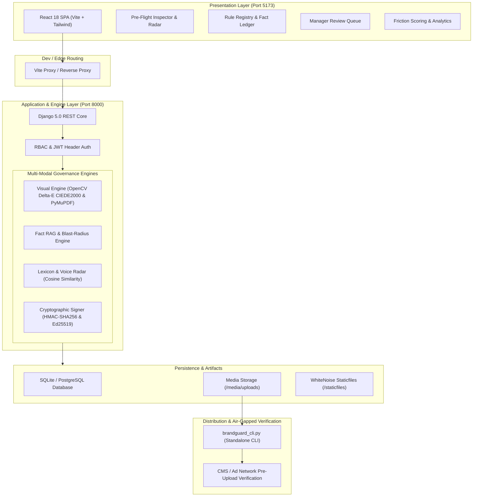

# BrandGuard — Enterprise Brand Governance, Pre-Publication Compiler & Cryptographic Asset Clearance Platform

[](https://www.djangoproject.com/)
[](https://react.dev/)
[](https://tailwindcss.com/)
[](https://opencv.org/)
[]()
[]()

> **BrandGuard** is an enterprise-grade pre-publication compliance compiler and cryptographic clearance engine. It prevents off-brand marketing assets, stale factual claims, and non-compliant visuals from ever reaching production by combining **multi-modal linting** (computer vision, tone analysis, living fact verification) with **tamper-proof digital signatures (HMAC-SHA256 & Ed25519)** embedded directly into media metadata.

---

## Table of Contents
- [Executive Overview](#executive-overview)
- [System Architecture](#system-architecture)
- [Core Functional Engines](#core-functional-engines)
- [Cryptographic Asset Clearance (Deep Dive)](#cryptographic-asset-clearance-deep-dive)
- [Air-Gapped Verification CLI](#air-gapped-verification-cli)
- [Role-Based Access Control (RBAC)](#role-based-access-control-rbac)
- [Local Development Quick Start](#local-development-quick-start)
- [Production Deployment Guide (Railway)](#production-deployment-guide-railway)
- [REST API Reference](#rest-api-reference)
- [Directory Structure](#directory-structure)

---

## Executive Overview

Modern enterprises face two major brand governance challenges:
1. **Content Drift & Stale Claims:** Product specifications, pricing, and regulatory disclosures change frequently, leaving published marketing assets legally vulnerable.
2. **Lack of Cryptographic Proof:** Once an image or document is approved, downstream CMS tools, ad agencies, and social schedulers have no verifiable way to confirm whether the asset was actually approved or subsequently altered.

**BrandGuard solves this deterministically:**
- **Pre-Flight Inspection:** Writers scan ad copy, social posts, banners, and PDFs against active brand rules before publishing.
- **Living Fact Ledger & Blast Radius:** If a claim expires (e.g. `FACT_012` pricing changes), the system calculates the retroactive blast-radius across all past collateral and triggers automated re-audits.
- **Cryptographic Clearance Seal:** Approved assets receive dual-key digital signatures (HMAC-SHA256 and Ed25519) embedded directly into PNG ancillary chunks (`tEXt`) and ISO-compliant PDF XMP metadata.
- **Offline Tamper Verification:** Anyone can verify the asset offline using the included CLI or CMS pre-upload webhooks without needing access to the private database.

---

## System Architecture



---

## Core Functional Engines

### 1. Multi-Modal Pre-Flight Audit Engine
- **Visual Color Delta (CIEDE2000):** Extracts dominant colors from uploaded banners/flyers using OpenCV and computes the perceptual color difference ($\Delta E_{00}$) against approved brand palettes (e.g. Midnight Emerald `#0A3423`, Teal `#00D4B6`). Flags deviations exceeding the threshold ($\Delta E > 4.0$).
- **WCAG 2.1 AA Contrast:** Validates text-to-background contrast ratios ($\ge 4.5:1$ for normal text, $\ge 3:1$ for large headings).
- **Layout Aspect Ratio:** Enforces strict aspect ratio compliance for digital ads (e.g., NovaPay banner standard: $3.5 \pm 0.2$).

### 2. Living Fact Ledger & Blast-Radius Engine
- Tracks active factual claims with expiration dates and verification citations (e.g. `FACT_012: 0.5% FX Fee`).
- **Retroactive Blast Radius:** When a fact is updated or expired, BrandGuard calculates which historical and pending collateral relied on that fact, identifying all affected marketing channels in seconds.
- **Bulk Re-Audit:** Triggers batch re-linting across all affected collateral with one click.

### 3. Voice Fingerprint & Lexicon Radar
- **Cosine Distance Projection:** Compares submitted copy against brand voice envelopes across four dimensions: *Formal vs Conversational*, *Technical vs Accessible*, *Confident vs Humble*, and *Direct vs Descriptive*.
- **Buzzword & Cliché Filter:** Flags forbidden industry clichés (*"in today's fast-paced landscape"*, *"delve into"*, *"testament to"*).
- **Readability Index:** Measures Flesch-Kincaid grade level to ensure clear consumer comprehension.

### 4. Telemetry & Friction Scoring
- Measures rule violation frequency across teams and calculates a normalized **Friction Score** ($0 - 100$).
- Identifies rules causing excessive team slowdowns or frequent exception requests, allowing governance teams to adjust policies dynamically.

---

## Cryptographic Asset Clearance (Deep Dive)

### Implementation in `backend/governance/views.py` (Lines 1011–1065)

```python
    clearance_hash = f"SHA256-{sig_obj.hmac_signature[:32]}"
    canonical_payload = sig_obj.canonical_payload
    hmac_sig = sig_obj.hmac_signature
    ed25519_sig = sig_obj.ed25519_signature
    ed25519_pub = sig_obj.ed25519_public_key

    # Embed Cryptographic Metadata (tEXt tags + ISO XMP) into Image / PDF Asset
    signed_rel_url = ""
    try:
        if source_path and source_path.exists():
            upload_dir = Path(settings.MEDIA_ROOT) / "uploads"
            upload_dir.mkdir(parents=True, exist_ok=True)
            suffix = source_path.suffix.lower()
            ...
```

### What This Code Does

When a Brand Governance Manager (Admin) approves an asset in the **Manager Review Queue**, the system executes a deterministic clearance protocol:

1. **Canonical Payload Construction (`canonical_payload`):**
   Computes a deterministic SHA-256 hash of the exact binary asset bytes combined with canonical metadata:
   $$\text{Payload} = \{\text{file\_hash}, \text{draft\_id}, \text{ruleset\_version}, \text{timestamp}, \text{approver\_username}\}$$

2. **Dual-Key Cryptographic Signatures:**
   - **`hmac_sig` (HMAC-SHA256):** Symmetric signature generated using the secret `BRANDGUARD_SECRET_KEY`. Guarantees internal database tamper-proofing.
   - **`ed25519_sig` & `ed25519_pub` (Ed25519 Elliptic Curve):** Modern public-key cryptography. External platforms (CMS, ad publishers, public auditors) can verify the signature using only `ed25519_pub` without exposing the internal private secret key.
   - **`clearance_hash`:** A short, human-readable identifier prefixed with `SHA256-` used for instant visual cross-referencing and audit trails.

3. **Non-Destructive Metadata Injection:**
   - **PNG Assets:** Embeds clearance tags into PNG ancillary chunks (`tEXt: BrandGuard_Clearance_Hash`, `BrandGuard_HMAC_Signature`, `BrandGuard_Ed25519_Signature`, `BrandGuard_Canonical_Payload`) and an ISO-compliant `XML:com.adobe.xmp` packet. **Pixel data is untouched and image quality is 100% preserved.**
   - **PDF Assets:** Injects XMP metadata packets and Document Information Dictionary entries (`/BrandGuard_Clearance`) via PyMuPDF.

4. **Tamper Detection:**
   If even a single pixel or word is modified downstream, the recalculation of the binary SHA-256 hash will mismatch the signed payload, causing offline verification to immediately fail.

---

## Air-Gapped Verification CLI

BrandGuard includes a standalone verification tool: [`brandguard_cli.py`](file:///d:/Programming%20Shit/Serious%20Projects/BrandGuard/brandguard_cli.py).

```bash
# Verify clearance and integrity of an asset
python brandguard_cli.py verify backend/media/sample_offbrand_banner.png --verbose

# Cryptographically sign and seal an asset via CLI
python brandguard_cli.py sign path/to/banner.png --approver "Jordan Lee" --draft-id "59829a20-7b33-4d64-bf78-c5d4beaa9318"

# Verify a detached payload
python brandguard_cli.py verify-payload --payload '{"file_hash":"...","draft_id":"..."}' --signature "<sig_hex>"
```

### CLI Verification Output Example:
```
====================================================================
  BRANDGUARD PRE-PUBLICATION COMPLIANCE & VERIFICATION CLI
  Deterministic Integrity · HMAC-SHA256 & Ed25519 Cryptographic Seals
====================================================================
Target Asset:     signed_sample_banner.png
File Hash:        e3b0c44298fc1c149afbf4c8996fb92427ae41e4649b934ca495991b7852b855
--------------------------------------------------------------------
[PASS] STATUS: BRAND-COMPLIANCE CLEARED
Clearance Hash:   SHA256-4f8a19bc...
HMAC Signature:   4f8a19bc712d93e1...
Ed25519 Signature:7a2e8c9b1f0d3a4e...
Approver:         Jordan Lee
Ruleset Version:  v3.2
Timestamp:        2026-10-25T07:45:00Z
Embedded XMP:     PRESENT (ISO Compliant)
Database Record:  OFFLINE VERIFIED (Cryptographically Valid)
--------------------------------------------------------------------
Legal Notice:     Cryptographically cleared under BrandGuard Governance v3.2.
====================================================================
```

---

## Role-Based Access Control (RBAC)

BrandGuard enforces strict role boundaries across frontend routes and backend REST endpoints:

| Role | Default Seed User | Password | Permissions & Views Accessible |
| :--- | :--- | :--- | :--- |
| **ADMIN** | `admin` | `admin123` | **Full Governance Access:** Rule Registry, Version Rollbacks, Living Fact Ledger, Manager Review Queue (Approval/Rejection), Team Provisioning, Telemetry Analytics, and PDF Exports. |
| **CONTENT_WRITER** | `writer1`<br>`writer2` | `writer123` | **Creator Workspace:** Pre-Flight Inspector, Live Linter, Voice Radar, Exception Request submission, and Personal Workspace history. *(Admin tabs display an HTTP 403 Forbidden Guard screen).* |

---

## Local Development Quick Start

### Prerequisites
- Python 3.11+
- Node.js 18+ and npm

### 1. Backend Setup (Terminal 1)
```powershell
cd backend
.\env\Scripts\activate
pip install -r requirements.txt
python manage.py migrate
python manage.py seed_demo
python manage.py runserver 127.0.0.1:8000
```

### 2. Frontend Setup (Terminal 2)
```powershell
cd frontend
npm install
npm run dev
```

### 3. Open in Browser
Visit **`http://localhost:5173`**. Click **"Jordan Lee (ADMIN)"** to sign in instantly.

---

## Production Deployment Guide (Railway)

Railway natively supports Linux containers with full OpenCV, SciPy, PyMuPDF, and persistent volumes.

### Architecture on Railway
- **`brandguard-backend` (Service 1):** Runs Django with Gunicorn and WhiteNoise on port `$PORT`. Mounted volume on `/app/backend` ensures SQLite and uploaded media persist indefinitely.
- **`brandguard-frontend` (Service 2):** Serves the compiled React bundle with dynamic API routing via `VITE_API_BASE`.

### Quick Setup Steps:
1. Push this repository to GitHub.
2. In [Railway](https://railway.app), click **New Project** ➔ **Deploy from GitHub Repo**.
3. **Backend Service:**
   - Root Directory: `/backend`
   - Variables:
     - `DJANGO_SETTINGS_MODULE` = `brandguard_core.settings`
     - `DEBUG` = `False`
     - `ALLOWED_HOSTS` = `*`
     - `SECRET_KEY` = `<your-production-secret>`
     - `BRANDGUARD_SECRET_KEY` = `<your-hmac-key>`
   - Generate Public Domain (e.g. `https://brandguard-api.up.railway.app`).
   - Add Volume: Mount `/app/backend`.
4. **Frontend Service:**
   - Add another service from the same repo.
   - Root Directory: `/frontend`
   - Variables:
     - `VITE_API_BASE` = `https://brandguard-api.up.railway.app`
   - Generate Public Domain.

---

## REST API Reference

| Method | Endpoint | Description | Access |
| :--- | :--- | :--- | :--- |
| `POST` | `/api/auth/login/` | Authenticates user; returns JWT bearer token | Public |
| `GET` | `/api/auth/me/` | Retrieves authenticated user profile & notifications | Authenticated |
| `POST` | `/api/submissions/audit/` | Runs multi-modal audit (visual, fact, tone) on text/file | Authenticated |
| `POST` | `/api/submissions/live-lint/` | Lightweight real-time text linting during typing | Authenticated |
| `POST` | `/api/submissions/<id>/approve/` | Cryptographically seals asset and signs PNG/PDF metadata | Admin Only |
| `POST` | `/api/submissions/verify-stamp/` | Verifies cryptographic seal on an uploaded file | Public / CMS |
| `GET` | `/api/rules/` | Lists active brand rules and guidelines | Authenticated |
| `POST` | `/api/rules/upload/` | Ingests and compiles raw text policy into structured rules | Admin Only |
| `POST` | `/api/rules/scrape/` | Scrapes external URL and extracts brand guidelines | Admin Only |
| `GET` | `/api/facts/` | Lists living fact ledger items and expiration statuses | Authenticated |
| `GET` | `/api/facts/<id>/blast-radius/` | Analyzes retroactive impact of updating/expiring a fact | Authenticated |
| `POST` | `/api/exceptions/` | Submits a writer exception request with business rationale | Writer / Admin |
| `POST` | `/api/exceptions/<id>/decide/` | Approves or rejects an exception request | Admin Only |
| `GET` | `/api/telemetry/` | Returns aggregated violation counts and Friction Scores | Admin Only |
| `GET` | `/api/submissions/<id>/export-pdf/` | Generates official executive PDF audit certificate with QR seal | Authenticated |

---

## Directory Structure

```
BrandGuard/
├── backend/
│   ├── brandguard_cli.py              # Standalone verification CLI
│   ├── brandguard_core/               # Django root configuration & WSGI
│   │   ├── settings.py                # Settings (WhiteNoise, CORS, DRF)
│   │   └── urls.py                    # API route dispatching
│   ├── governance/                    # BrandGuard Core Governance App
│   │   ├── auth.py                    # JWT authentication & session resolution
│   │   ├── crypto_sign.py             # HMAC-SHA256 & Ed25519 signing engine
│   │   ├── pdf_report.py              # Executive PDF audit certificate generator
│   │   ├── scraper.py                 # URL scraper with SSRF protection
│   │   ├── rule_parser.py             # Policy document compiler
│   │   ├── models.py                  # Database schema (Rules, Facts, Signatures)
│   │   ├── views.py                   # REST API controllers
│   │   ├── engines/
│   │   │   ├── visual_engine.py       # OpenCV CIEDE2000 & PyMuPDF visual auditor
│   │   │   ├── fact_rag_engine.py     # Fact verification & blast-radius engine
│   │   │   ├── lexicon_engine.py      # Tone radar & cliché filters
│   │   │   └── telemetry.py           # Friction Score aggregation
│   │   └── management/commands/
│   │       └── seed_demo.py           # NovaPay seed script
│   ├── Procfile                       # Railway / Heroku process declaration
│   ├── railway.json                   # Railway Nixpacks deployment config
│   └── requirements.txt               # Backend dependencies
├── frontend/
│   ├── src/
│   │   ├── config/api.js              # Dynamic API URL resolution
│   │   ├── context/                   # AuthContext, ThemeContext, LanguageContext
│   │   ├── components/
│   │   │   ├── PreFlightInspectorView # Creator audit & live radar UI
│   │   │   ├── RuleDetailView.jsx     # Rule registry & living facts editor
│   │   │   ├── ManagerQueueView.jsx   # Manager review & cryptographic sign-off
│   │   │   ├── TelemetryView.jsx      # Governance friction metrics
│   │   │   ├── WorkspacesView.jsx     # Past submissions & audit trails
│   │   │   ├── TeamManagementView.jsx # Writer metrics & provisioning
│   │   │   ├── ForbiddenGuard.jsx     # 403 Access control guard
│   │   │   └── LoginView.jsx          # Persona switcher & authentication
│   │   ├── App.jsx                    # Root tab controller
│   │   └── main.jsx                   # React DOM mount point
│   ├── package.json                   # Vite & React dependencies
│   ├── railway.json                   # Railway frontend deployment config
│   ├── vercel.json                    # Vercel SPA rewrite configuration
│   └── vite.config.js                 # Dev server proxy configuration
├── brandguard_cli.py                  # Root CLI wrapper
└── README.md                          # Platform documentation
```

---

## License & Security Notice

BrandGuard is engineered for enterprise governance. Cryptographic signatures generated by BrandGuard are protected by dual HMAC-SHA256 and Ed25519 protocols. Tampering with approved media headers, canonical payloads, or pixel data invalidates compliance clearance deterministically across all auditing nodes.
